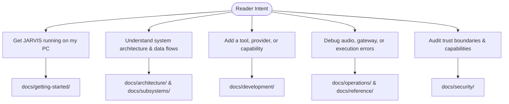

# JARVIS Technical Documentation Portal

Welcome to the definitive engineering knowledge base for **JARVIS**, an autonomous, stateful, multimodal AI operating system for Windows desktop coordination, real-time voice and vision cognition, and system execution.

This documentation serves human software engineers, system operators, and autonomous AI coding agents, providing an implementation-verified reference for the entire JARVIS codebase.

---

## 1. Documentation Map by Reader Intent

Choose the guide that matches your immediate goal:

- **New Developers**: Start with [Installation](getting-started/installation.md), [Configuration](getting-started/configuration.md), and [First Run](getting-started/first-run.md).
- **Architects & Engineers**: Review [System Overview](architecture/system-overview.md), [Control Plane](architecture/control-plane.md), and [Canonical Architecture](../ARCHITECTURE.md).
- **Contributors**: Review [Contributing Guide](development/contributing.md), [Adding a Tool](development/adding-a-tool.md), and [AI Agent Guidelines](development/agent-guidelines.md).
- **Operators**: Review [Startup & Shutdown](operations/startup-and-shutdown.md), [Troubleshooting](operations/troubleshooting.md), and [Configuration Reference](reference/configuration-reference.md).

---

## 2. Complete Knowledge Base Structure

### 2.1. Getting Started
Foundational onboarding, environment setup, and verification.
- **[Installation Guide](getting-started/installation.md)**: System prerequisites, Python environment setup, Node.js dependencies, and audio drivers.
- **[Configuration Guide](getting-started/configuration.md)**: Environment variables, `.env` files, API keys, and parameter precedence.
- **[First Run Experience](getting-started/first-run.md)**: Launching JARVIS, verifying audio loopback, and executing your first command.
- **[Development Setup](getting-started/development-setup.md)**: Setting up Git worktrees, editable package installations, and developer toolchains.

### 2.2. Core Architecture
High-level system design, data flows, and cognitive mechanisms.
- **[System Architecture Overview](architecture/system-overview.md)**: Component topography, C4 context diagrams, and inter-subsystem communication.
- **[Control Plane Engine](architecture/control-plane.md)**: Turn lifecycle coordination, memory compaction, and event broadcasting.
- **[Execution Lifecycle](architecture/execution-lifecycle.md)**: Closed-loop Observe $\rightarrow$ Act $\rightarrow$ Verify execution paradigm.
- **[Cognitive Model Routing](architecture/model-routing.md)**: Task complexity scoring, priority candidate chains, and provider fallback logic.
- **[Memory and Persistence](architecture/memory-and-persistence.md)**: Dual-store SQLite WAL + FTS5 full-text indexing, temporal decay ranking, and standing intents.
- **[Master Architecture Specification](../ARCHITECTURE.md)**: The canonical 13-section technical architecture specification.

### 2.3. Subsystems
Deep technical specifications for each architectural domain.
- **[Voice & Realtime Audio](subsystems/voice-and-audio.md)**: Duplex audio streaming, voice state transitions, and barge-in interruption.
- **[Acoustic Echo Cancellation (AEC)](subsystems/audio-aec.md)**: WASAPI digital loopback, PBFDAF filtering, double-talk detection, and spectral suppression.
- **[Signal Orb & Neural UI](subsystems/signal-orb-and-ui.md)**: 12,000-particle Fibonacci WebGL orb, typography flight, and wall-clock synchronization.
- **[Gateway & WebSockets](subsystems/gateway-and-websockets.md)**: WebSocket server, challenge-response handshake, and JSON-RPC wire frames.
- **[Action Broker & Capability Firewall](subsystems/action-broker-and-policy.md)**: Capability bitmasks, risk evaluation tiers, and interactive approval flows.
- **[Windows Automation Engine](subsystems/windows-automation.md)**: AppRegistry discovery, AppLauncher, WindowManager, and COM UI Automation.
- **[Execution Substrate (Node.js)](subsystems/execution-substrate.md)**: High-speed TypeScript substrate daemon, stdio JSON-RPC IPC, and tool repair.
- **[Browser Automation Engine](subsystems/browser-automation.md)**: Playwright Chromium CDP sessions, accessibility trees, and DOM interactions.

### 2.4. Integrations
External bridges and communication adapters.
- **[Integrations Overview](integrations/overview.md)**: Capability matrix across Telegram, WhatsApp, and browser integrations.
- **[Telegram Remote Control](integrations/telegram.md)**: Dedicated mobile daemon, cryptographic pairing, inline approvals, and direct file delivery.
- **[WhatsApp Desktop & VoIP](integrations/whatsapp.md)**: Baileys WebRTC VoIP audio bridge, autonomous outbound calling, and AI debriefing.
- **[WhatsApp Upstream Manifest](integrations/whatsapp-upstream.md)**: Provenance, pinned revisions, and vendor boundaries for upstream protocol libraries.

### 2.5. Operations & Maintenance
Operational runbooks, CI pipelines, and troubleshooting guides.
- **[Startup and Shutdown](operations/startup-and-shutdown.md)**: Bootstrapping order, OS signal handling, WAL checkpointing, and graceful teardown.
- **[Testing and Continuous Integration](operations/testing-and-ci.md)**: Test suites, local verification commands, and GitHub Actions CI pipelines.
- **[Troubleshooting Guide](operations/troubleshooting.md)**: Diagnostic checklists, audio clipping fixes, WebSocket debugging, and database unlocking.

### 2.6. Technical Reference
Exhaustive reference specifications and schemas.
- **[Configuration Reference](reference/configuration-reference.md)**: Exhaustive catalog of all 60+ settings, types, defaults, and descriptions.
- **[CLI Reference Manual](reference/cli-reference.md)**: Complete guide to all `jarvis` CLI commands, flags, and options.
- **[Protocols and Event Schemas](reference/protocols-and-events.md)**: JSON Schemas for Gateway frames and Substrate IPC messages.
- **[Data Models & Storage Schema](reference/data-models-and-storage.md)**: SQLite relational schema, FTS5 virtual tables, and index layout.
- **[Repository Structural Map](reference/repository-map.md)**: File-by-file directory tree, subsystem ownership, and module responsibilities.

### 2.7. Development & Extension
Guides for extending and modifying JARVIS.
- **[Contributing Guide](development/contributing.md)**: Code standards, commit standards, and pull request workflows.
- **[Adding a Tool](development/adding-a-tool.md)**: Step-by-step tutorial on defining, securing, and registering a new system tool.
- **[Adding a Model Provider](development/adding-a-model-provider.md)**: Guide for integrating custom or local LLM inference engines.
- **[AI Agent Guidelines](development/agent-guidelines.md)**: Operational protocols, prime invariants, and safety constraints for autonomous coding agents.

### 2.8. Security & Trust Architecture
- **[Threat Model and Trust Architecture](security/threat-model-and-trust.md)**: Formal threat model, security boundaries, risk tiers, and defense-in-depth mitigations.

---

## 3. Core Architectural Philosophy

1. **The Model is Not the Trust Boundary**: LLMs generate natural responses and propose tool calls, but the local Python control plane enforces policy, validation, capability checks, and user approvals.
2. **Never Hardcode Anything**: Configurations, paths, timeouts, models, and endpoints are discoverable and dynamically resolved via `JarvisSettings` or runtime context. Cross-platform path abstractions (`pathlib.Path`) are mandatory.
3. **Closed-Loop Execution**: All system-altering actions must follow an Observe $\rightarrow$ Act $\rightarrow$ Verify sequence to confirm state transitions before reporting completion.
4. **Deterministic Audio Isolation**: Real-time microphone audio is filtered using hardware loopback reference subtraction, preventing assistant self-echo or speaker contamination.
5. **Quality Verification Gates**: 100% test pass rate (`pytest`), 100% strict type safety (`mypy src tests`), and 100% clean formatting and linting (`ruff`).
