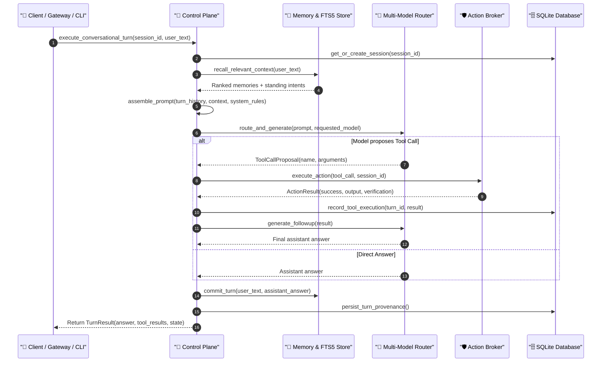

# Cognitive Control Plane & Orchestration

The **Cognitive Control Plane** ([`src/jarvis/core/control_plane.py`](file:///C:/Users/deepa/OneDrive/Desktop/JARVIS-WORKSPACE/src/jarvis/core/control_plane.py)) serves as the central nervous system of JARVIS. It coordinates conversational turns, memory recall, multi-model delegation, tool action dispatch, and state persistence across all active sessions.

---

## 1. Architectural Role & Responsibilities

The Control Plane decouples user communication channels (Desktop Web UI, Console CLI, Telegram daemon, WhatsApp) from the underlying cognitive models and execution drivers.

### Key Responsibilities:
1. **Session State Lifecycle:** Initializes, resumes, and persists stateful interaction sessions across restarts.
2. **Context Assembly & Dynamic Retrieval:** Queries SQLite FTS5 for semantically relevant memories, learned user preferences, and recent observations.
3. **Intent Classification & Model Routing:** Evaluates user goals and routes sub-tasks to specialized models (Gemini Live, GPT-OSS 120B, Qwen 3.8 27B).
4. **Governed Action Brokerage:** Dispatches model tool proposals to the Action Broker, enforcing Capability Firewall rules and operator approval gates.
5. **Conversational Compaction:** Automatically summarizes and compacts older dialogue turns to preserve token budgets while retaining the user's primary objective.

---

## 2. Conversational Turn Execution

Every interaction handled by the Control Plane executes through the `execute_conversational_turn` method:



---

## 3. Working Memory Management & Turn Compaction

As conversational turns accumulate, token budgets on LLM context windows can become saturated. The `WorkingMemory` subsystem ([`src/jarvis/memory/working.py`](file:///C:/Users/deepa/OneDrive/Desktop/JARVIS-WORKSPACE/src/jarvis/memory/working.py)) enforces deterministic compaction:

- **Turn Trimming:** If `len(turns) > max_turns`, JARVIS retains the very first turn (preserving the original user goal) and trims the oldest intermediate turns:
  ```python
  self.turns = [self.turns[0], *self.turns[-(self.max_turns - 1) :]]
  ```
- **Scratchpad:** A thread-safe, ephemeral key-value dictionary for holding transient plan variables, calculation results, and verification flags during a single conversational turn.
- **Active Plan Tracking:** Holds the multi-step execution plan currently being pursued by specialist agents.

---

## 4. Multi-Agent Delegation & Specialist Swarms

When a complex objective is received (e.g. *"Refactor the audio filter and run the test suite"*), the Control Plane leverages the `AgentDelegator` ([`src/jarvis/agents/delegator.py`](file:///C:/Users/deepa/OneDrive/Desktop/JARVIS-WORKSPACE/src/jarvis/agents/delegator.py)):

- Spawns specialized worker personas (`CoderAgent`, `ResearchAgent`, `DesktopAgent`).
- Bounded recursion depth: Constrained by `settings.MAX_SUBAGENT_DEPTH` (default: 3) to prevent runaway execution loops.
- All actions proposed by delegated subagents must pass through the parent session's Policy Engine and Capability Firewall.

---

## 5. Failure Handling & Recovery Semantics

- **Model Timeout:** When an external model fails to respond within `settings.DEFAULT_TIMEOUT_SECONDS` (default: 60s), the Control Plane falls back down the candidate model chain.
- **Tool Execution Exception:** If an action fails (e.g. window not found, permission denied), the exception is captured into `ActionResult(success=False, error=str(err))` and fed back to the cognitive loop, allowing the model to self-correct or transition to alternative providers.
- **Graceful Session Persistence:** In the event of process interruption, the session database state is committed in WAL mode, allowing complete resumption upon the next boot.
