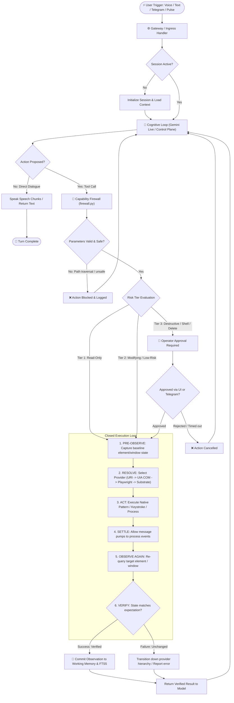

# Execution Lifecycle & Verification Loop

Every side-effecting interaction in the **JARVIS Personal AI Operating System** is governed by an explicit closed-loop execution paradigm:

$$\text{Observe} \longrightarrow \text{Resolve} \longrightarrow \text{Evaluate Policy} \longrightarrow \text{Act} \longrightarrow \text{Observe Again} \longrightarrow \text{Verify}$$

JARVIS rejects open-loop "blind fire-and-forget" execution. Actions are never assumed to succeed; completion is reported only after post-action state verification confirms the expected change.

---

## 1. End-to-End Request Lifecycle Flow

---

## 2. Step-by-Step Lifecycle Analysis

### Step 1: Input Ingress & Session State Activation
- **Channels:** Incoming requests arrive through the **Gateway WebSocket** (`frontend/`), **Live Dialogue Host** (`gemini_live.py`), **Telegram Daemon** (`telegram/service.py`), or **CLI** (`commands.py`).
- **Session Resolution:** The active session is retrieved or initialized from SQLite WAL storage.

### Step 2: Context Injection & Proposal Formulation
- Relevant facts and standing intents are recalled from the SQLite FTS5 database using semantic and temporal decay ranking.
- The cognitive model evaluates the prompt and emits either:
  1. *Spoken Audio / Direct Text Answer*
  2. *Tool Call Proposal* (e.g. `window_focus`, `app_launch`, `ui_interact`, `shell_execute`).

### Step 3: Capability Firewall & Risk Tier Classification
The proposed action name is checked against canonical capabilities ([`src/jarvis/policy/firewall.py`](file:///C:/Users/deepa/OneDrive/Desktop/JARVIS-WORKSPACE/src/jarvis/policy/firewall.py)):
- **Tier 1 (Read-Only):** `filesystem.read`, `window.list`, `ui.inspect`, `computer.screenshot`. Executed immediately.
- **Tier 2 (Modifying / Low-Risk):** `app.launch`, `window.focus`, `ui.interact`, `system.volume`. Executed with audit logging.
- **Tier 3 (High-Risk / Destructive):** `filesystem.delete`, `process.terminate`, `shell.execute`. Execution pauses; an interactive confirmation card is dispatched to the Web UI or paired Telegram device.

### Step 4: Closed Execution Loop (Observe $\rightarrow$ Act $\rightarrow$ Verify)
When execution proceeds:
1. **Pre-Action Observation:** Queries the target window handle (HWND) or UIA node to record current bounds, focus, and value.
2. **Provider Selection:** Evaluates the deterministic hierarchy:
   - *Tier 1:* Programmatic URI scheme (`spotify:`, `vscode:`)
   - *Tier 2:* Native COM UI Automation (`IUIAutomationInvokePattern`, `IUIAutomationValuePattern`)
   - *Tier 3:* Playwright CDP session (if web content)
   - *Tier 4:* Coordinate mouse click or keyboard input via Node.js Execution Substrate.
3. **Execution & Settling Delay:** Dispatches the command. A bounded delay (e.g. 50-250ms) allows target application Windows message pumps to process events.
4. **Post-Action Observation:** Re-queries the element or window state.
5. **Deterministic Verification:**
   - *Text Input:* Compares element value with the injected string.
   - *Button Click:* Verifies that element state changed, a dialog dismissed, or a new window handle appeared.
   - *Window Focus:* Verifies `GetForegroundWindow() == target_hwnd`.

### Step 5: Result Reporting & Memory Commitment
- Structured execution metadata (`ActionResult(success=True, output=..., verification="VERIFIED")`) is returned to the model.
- If verified, the observation is committed to the session turn log and indexed into SQLite FTS5 full-text memory.
- If unverified, the failure is returned to the cognitive loop, enabling the model to attempt an alternative approach or report the obstruction to the operator.
