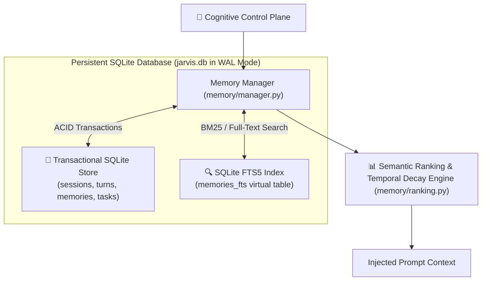
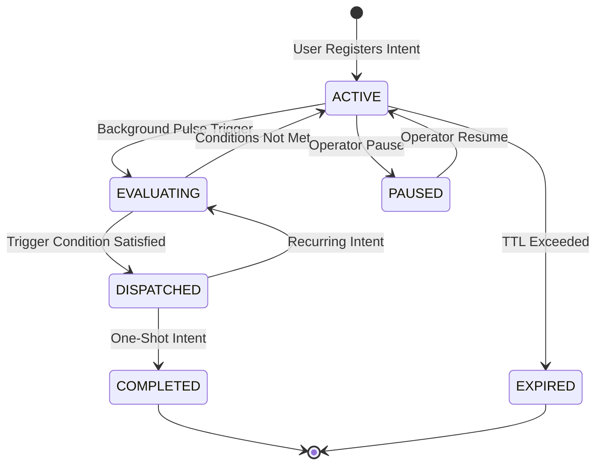

# Memory Fabric, Standing Intents & Persistence

JARVIS maintains persistent conversational state, learned preferences, execution history, and standing automation goals across restarts using a **Dual-Store Architecture** ([`src/jarvis/storage/database.py`](file:///C:/Users/deepa/OneDrive/Desktop/JARVIS-WORKSPACE/src/jarvis/storage/database.py)) backed by SQLite.

---

## 1. Dual-Store Architecture



### Components:
1. **Transactional SQLite Store (WAL Mode):**
   - High-concurrency Write-Ahead Logging (`PRAGMA journal_mode=WAL;`).
   - Stores sessions, turns, tool outputs, policy audit logs, and standing intents.
2. **SQLite FTS5 Full-Text Search Index:**
   - Tokenizes facts, observations, and user preferences using Porter stemming.
   - Provides sub-millisecond keyword and BM25 relevance lookups without requiring heavy external vector database daemons.

---

## 2. Semantic Ranking with Exponential Temporal Decay

When user queries arrive, candidate memories recalled from FTS5 are ranked using a composite scoring formula implemented in [`src/jarvis/memory/ranking.py`](file:///C:/Users/deepa/OneDrive/Desktop/JARVIS-WORKSPACE/src/jarvis/memory/ranking.py):

$$S = \text{Similarity}(Q, M) \times e^{-\lambda \Delta t} \times \text{Importance}$$

Where:
- $\text{Similarity}(Q, M)$: Jaccard token similarity and BM25 full-text score.
- $\Delta t$: Elapsed time in days since the memory was created or last reinforced.
- $\lambda$: Temporal decay constant derived from the configured half-life:
  $$\lambda = \frac{\ln(2)}{t_{1/2}}$$
- $\text{Importance}$: Normalized multiplier ($0.1 - 2.0$) assigned to permanent directives (e.g. *"Never delete files without asking"* receives max importance).

### Maximal Marginal Relevance (MMR) Re-Ranking
To prevent polluting context windows with near-duplicate memories (e.g. 10 identical observations of a window opening), the memory engine applies MMR re-ranking:

$$\text{MMR} = \operatorname{argmax}_{d_i \in R \setminus S} \left[ \lambda \operatorname{Sim}_1(d_i, Q) - (1 - \lambda) \max_{d_j \in S} \operatorname{Sim}_2(d_i, d_j) \right]$$

---

## 3. Standing Intent Cron Engine

JARVIS can maintain autonomous long-running goals that trigger outside direct user conversations ([`src/jarvis/cron/scheduler.py`](file:///C:/Users/deepa/OneDrive/Desktop/JARVIS-WORKSPACE/src/jarvis/cron/scheduler.py) & [`src/jarvis/memory/standing_intents.py`](file:///C:/Users/deepa/OneDrive/Desktop/JARVIS-WORKSPACE/src/jarvis/memory/standing_intents.py)):



### Examples of Standing Intents:
- *"Notify me on Telegram if disk space on drive C falls below 10GB."*
- *"If an email arrives from my accountant on WhatsApp, alert me immediately."*
- *"Every weekday at 9:00 AM, inspect today's calendar and prepare a spoken briefing."*

---

## 4. Database Schema Overview

```sql
-- Core interaction turns
CREATE TABLE turns (
    id TEXT PRIMARY KEY,
    session_id TEXT NOT NULL,
    role TEXT NOT NULL,
    content TEXT NOT NULL,
    tool_calls TEXT,
    created_at TIMESTAMP DEFAULT CURRENT_TIMESTAMP,
    FOREIGN KEY(session_id) REFERENCES sessions(id)
);

-- Long-term declarative and episodic memory
CREATE TABLE memories (
    id TEXT PRIMARY KEY,
    category TEXT NOT NULL,
    content TEXT NOT NULL,
    importance REAL DEFAULT 1.0,
    created_at TIMESTAMP DEFAULT CURRENT_TIMESTAMP,
    last_accessed TIMESTAMP DEFAULT CURRENT_TIMESTAMP
);

-- FTS5 full-text search virtual table
CREATE VIRTUAL TABLE memories_fts USING fts5(
    content,
    category,
    tokenize='porter unicode61'
);
```
