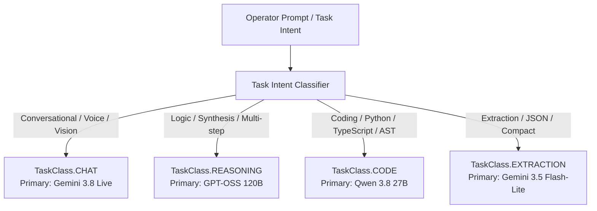

# Multi-Model Router & Cognitive Delegation

JARVIS implements an intelligent **Multi-Model Router** ([`src/jarvis/cognition/model_router.py`](file:///C:/Users/deepa/OneDrive/Desktop/JARVIS-WORKSPACE/src/jarvis/cognition/model_router.py)) that dynamically classifies incoming task objectives and delegates them across an approved allowlist of specialized frontier and open-weight models.

---

## 1. The Strict 6-Model Allowlist

To maintain deterministic behavior, predictable token costs, and strict privacy boundaries, JARVIS permits only six authorized model families:

| Model Family | Primary Role & Domain | Provider Implementation | Model Mapping Key |
| :--- | :--- | :--- | :--- |
| **Gemini 3.8 Live** | Full-duplex conversational voice, visual screen perception, live tool proposals | `GoogleGenAIProvider` | `MODEL_MAP_GEMINI_LIVE` |
| **GPT-OSS 120B** | Deep logical reasoning, architectural planning, complex synthesis | `GroqProvider` / OpenAI API | `MODEL_MAP_GPT_OSS_120B` |
| **Qwen 3.8 27B** | Code generation, syntactic analysis, script refactoring, bug fixes | `GroqProvider` / Local vLLM | `MODEL_MAP_QWEN_3_8_27B` |
| **Gemini 3.5 Flash-Lite**| Fast text processing, conversation compaction, summarization | `GoogleGenAIProvider` | `MODEL_MAP_GEMINI_3_5_FLASH_LITE` |
| **Gemini 3.1 Flash-Lite**| Low-latency JSON extraction, entity extraction, classification | `GoogleGenAIProvider` | `MODEL_MAP_GEMINI_3_1_FLASH_LITE` |
| **Gemma 4 31B** | Edge execution, low-power fallback, private local reasoning | `GoogleGenAIProvider` / Ollama | `MODEL_MAP_GEMMA_4_31B` |

---

## 2. Intent Classification & Task Classes

When a user submits an objective or task, the router runs an intent classifier to assign the request to a canonical `TaskClass`:



---

## 3. Candidate Chains & Dynamic Fallback

For each `TaskClass`, the router computes a deterministic ordered list of candidate models. If the primary model fails, encounters rate limiting, or exhausts its token budget, the router seamlessly falls back to the next candidate:

### Candidate Hierarchies:
- **`TaskClass.CODE`**:  
  `Qwen 3.8 27B` $\longrightarrow$ `GPT-OSS 120B` $\longrightarrow$ `Gemini 3.5 Flash-Lite`
- **`TaskClass.REASONING`**:  
  `GPT-OSS 120B` $\longrightarrow$ `Qwen 3.8 27B` $\longrightarrow$ `Gemini 3.5 Flash-Lite`
- **`TaskClass.CHAT`**:  
  `Gemini 3.8 Live` $\longrightarrow$ `Gemini 3.5 Flash-Lite` $\longrightarrow$ `Gemma 4 31B`
- **`TaskClass.EXTRACTION`**:  
  `Gemini 3.1 Flash-Lite` $\longrightarrow$ `Gemini 3.5 Flash-Lite` $\longrightarrow$ `Qwen 3.8 27B`

---

## 4. Quota Manager & Feasibility Evaluation

Before dispatching a generation request to any model provider, the **Quota Manager** ([`src/jarvis/cognition/quota_manager.py`](file:///C:/Users/deepa/OneDrive/Desktop/JARVIS-WORKSPACE/src/jarvis/cognition/quota_manager.py)) verifies runtime feasibility:

```python
can_run = await self.quotas.can_schedule(
    model_family=candidate,
    estimated_tokens=estimated_tokens,
)
```

### Metrics Tracked:
1. **RPM (Requests Per Minute):** Prevents exceeding provider API rate limits.
2. **TPM (Tokens Per Minute):** Dynamically paces token consumption.
3. **Consecutive Error Count:** If a provider encounters 3 consecutive network/server errors, the Quota Manager marks the provider as degraded for a cooling-off period (e.g. 60 seconds), routing requests directly to the fallback candidate.

---

## 5. Adding or Overriding Model Mappings

All model identifiers are dynamically configurable via environment variables in `.env` without modifying code:

```ini
# Route Qwen 3.8 requests to an on-premise local vLLM or alternative Groq model:
MODEL_MAP_QWEN_3_8_27B="qwen/qwen-2.5-coder-32b-instruct"

# Route GPT-OSS requests to OpenAI or Azure endpoint:
MODEL_MAP_GPT_OSS_120B="openai/gpt-4o"
```
