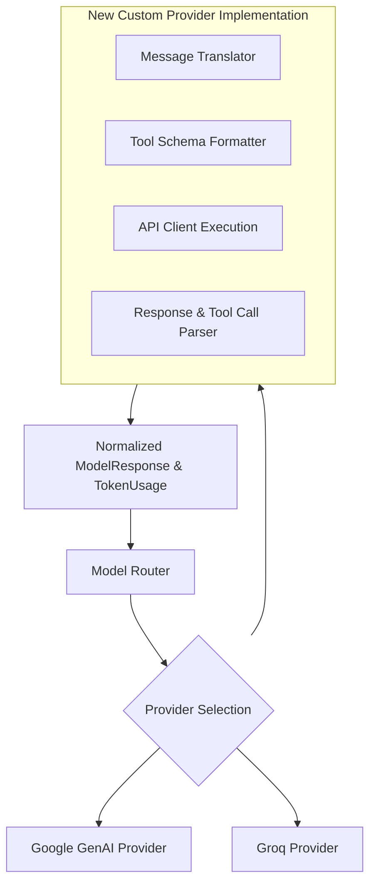

# Adding a Model Provider to JARVIS

This guide explains how to integrate a new Large Language Model (LLM) provider into the JARVIS cognitive architecture.

---

## 1. Cognition Architecture Overview

JARVIS uses a modular provider abstraction to route queries across multiple model backends:



Every provider must implement the `BaseModelProvider` interface defined in [`src/jarvis/cognition/providers/base.py`](file:///C:/Users/deepa/OneDrive/Desktop/JARVIS-WORKSPACE/src/jarvis/cognition/providers/base.py).

---

## 2. Implementing `BaseModelProvider`

Below is a complete implementation example integrating an OpenAI-compatible or local inference endpoint (e.g., vLLM or Ollama).

### Step 2.1: Define Provider Class

Create `src/jarvis/cognition/providers/custom_provider.py`:

```python
import os
from typing import AsyncGenerator, List, Dict, Any, Optional
import httpx

from jarvis.cognition.providers.base import BaseModelProvider
from jarvis.contracts.model import (
    ModelRequest,
    ModelResponse,
    TokenUsage,
    ToolCallRequest,
)


class CustomInferenceProvider(BaseModelProvider):
    """Integrates an OpenAI-compatible or local inference model provider."""

    def __init__(self, api_key: Optional[str] = None, base_url: str = "http://localhost:8000/v1"):
        self.api_key = api_key or os.getenv("CUSTOM_LLM_API_KEY", "")
        self.base_url = base_url.rstrip("/")
        self.client = httpx.AsyncClient(
            base_url=self.base_url,
            headers={"Authorization": f"Bearer {self.api_key}"} if self.api_key else {},
            timeout=60.0,
        )

    async def generate(self, request: ModelRequest) -> ModelResponse:
        """Executes a non-streaming completion with tool support."""
        messages = self._format_messages(request)
        tools = self._format_tools(request.available_tools)

        payload: Dict[str, Any] = {
            "model": request.model_name,
            "messages": messages,
            "temperature": request.temperature,
            "max_tokens": request.max_tokens or 4096,
        }
        if tools:
            payload["tools"] = tools
            payload["tool_choice"] = "auto"

        response = await self.client.post("/chat/completions", json=payload)
        response.raise_for_status()
        data = response.json()

        choice = data["choices"][0]
        message = choice["message"]
        content = message.get("content") or ""
        raw_tool_calls = message.get("tool_calls") or []

        tool_calls: List[ToolCallRequest] = []
        for call in raw_tool_calls:
            tool_calls.append(
                ToolCallRequest(
                    call_id=call["id"],
                    tool_name=call["function"]["name"],
                    arguments=call["function"]["arguments"],
                )
            )

        usage = data.get("usage", {})
        token_usage = TokenUsage(
            prompt_tokens=usage.get("prompt_tokens", 0),
            completion_tokens=usage.get("completion_tokens", 0),
            total_tokens=usage.get("total_tokens", 0),
        )

        return ModelResponse(
            text=content,
            tool_calls=tool_calls,
            model_name=request.model_name,
            provider_name="custom_inference",
            usage=token_usage,
            finish_reason=choice.get("finish_reason", "stop"),
        )

    async def stream_generate(self, request: ModelRequest) -> AsyncGenerator[str, None]:
        """Streams incremental text tokens for low-latency voice responses."""
        messages = self._format_messages(request)
        payload = {
            "model": request.model_name,
            "messages": messages,
            "stream": True,
            "temperature": request.temperature,
        }
        async with self.client.stream("POST", "/chat/completions", json=payload) as stream:
            stream.raise_for_status()
            async for line in stream.aiter_lines():
                if not line or not line.startswith("data: "):
                    continue
                data_str = line[6:].strip()
                if data_str == "[DONE]":
                    break
                import json

                chunk = json.loads(data_str)
                delta = chunk["choices"][0]["delta"].get("content")
                if delta:
                    yield delta

    def _format_messages(self, request: ModelRequest) -> List[Dict[str, Any]]:
        """Converts internal TurnRecord structures to provider message dictionaries."""
        formatted: List[Dict[str, Any]] = []
        if request.system_instruction:
            formatted.append({"role": "system", "content": request.system_instruction})

        for turn in request.turns:
            formatted.append({"role": turn.role, "content": turn.content})
        return formatted

    def _format_tools(self, tools: List[Dict[str, Any]]) -> List[Dict[str, Any]]:
        """Wraps tool schemas in provider-compatible JSON structures."""
        formatted_tools = []
        for tool in tools:
            formatted_tools.append(
                {
                    "type": "function",
                    "function": {
                        "name": tool["name"],
                        "description": tool["description"],
                        "parameters": tool["parameters"],
                    },
                }
            )
        return formatted_tools
```

---

## 3. Registering the Provider in `ModelRouter`

Open [`src/jarvis/cognition/model_router.py`](file:///C:/Users/deepa/OneDrive/Desktop/JARVIS-WORKSPACE/src/jarvis/cognition/model_router.py) to wire the provider into the router factory:

```python
from jarvis.cognition.providers.custom_provider import CustomInferenceProvider


class ModelRouter:
    def _initialize_providers(self) -> None:
        # Existing providers
        if self.settings.google_api_key:
            self.providers["google"] = GoogleGenAIProvider(self.settings.google_api_key)
        if self.settings.groq_api_key:
            self.providers["groq"] = GroqProvider(self.settings.groq_api_key)

        # Register new provider
        if hasattr(self.settings, "custom_llm_base_url") and self.settings.custom_llm_base_url:
            self.providers["custom"] = CustomInferenceProvider(
                api_key=self.settings.custom_llm_api_key,
                base_url=self.settings.custom_llm_base_url,
            )
```

---

## 4. Updating Configuration Schema

Add corresponding environment variables to `JarvisSettings` in [`src/jarvis/config.py`](file:///C:/Users/deepa/OneDrive/Desktop/JARVIS-WORKSPACE/src/jarvis/config.py):

```python
class JarvisSettings(BaseSettings):
    # Custom provider settings
    custom_llm_api_key: Optional[str] = Field(default=None, alias="CUSTOM_LLM_API_KEY")
    custom_llm_base_url: Optional[str] = Field(default=None, alias="CUSTOM_LLM_BASE_URL")
    custom_llm_model: str = Field(default="custom-model", alias="CUSTOM_LLM_MODEL")
```

---

## 5. Adding Candidate Chains and Fallbacks

In `src/jarvis/cognition/model_router.py`, include the new model in the candidate selection chain:

```python
def get_candidate_chain_for_task(self, complexity: TaskComplexity) -> List[str]:
    if complexity == TaskComplexity.SIMPLE:
        return [self.settings.custom_llm_model, "gemini-3.1-flash-lite", "llama-3.3-70b-versatile"]
    return ["gemini-3.5-flash-lite", "gemini-3.1-flash-lite"]
```

---

## 6. Testing the Provider

Create a unit test in `tests/unit/test_providers.py` using a mock HTTP transport to verify request formation, token calculation, and tool parsing:

```python
import pytest
from jarvis.cognition.providers.custom_provider import CustomInferenceProvider
from jarvis.contracts.model import ModelRequest, TurnRecord


@pytest.mark.asyncio
async def test_custom_provider_generate(monkeypatch):
    provider = CustomInferenceProvider(api_key="mock-key", base_url="http://test.local/v1")

    # Mock HTTP response
    async def mock_post(*args, **kwargs):
        class MockResponse:
            def raise_for_status(self):
                pass

            def json(self):
                return {
                    "choices": [
                        {
                            "message": {"content": "Hello user", "tool_calls": []},
                            "finish_reason": "stop",
                        }
                    ],
                    "usage": {"prompt_tokens": 10, "completion_tokens": 5, "total_tokens": 15},
                }

        return MockResponse()

    monkeypatch.setattr(provider.client, "post", mock_post)

    request = ModelRequest(
        model_name="test-model",
        turns=[TurnRecord(role="user", content="Hello")],
    )
    response = await provider.generate(request)
    assert response.text == "Hello user"
    assert response.usage.total_tokens == 15
    assert response.provider_name == "custom_inference"
```
