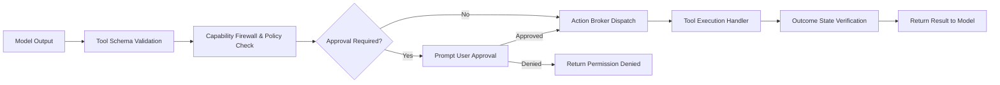

# Adding a Tool to JARVIS

This tutorial walks through creating, registering, securing, and testing a new tool within the JARVIS Action Subsystem.

---

## 1. Tool Architecture Overview

When an LLM decides to call a tool, the invocation passes through several protective layers:



To add a tool, you must complete four steps:
1. Define the tool schema and argument contract.
2. Assign capability permissions and a risk tier.
3. Implement the execution handler and verification logic.
4. Register the tool in `ActionRegistry`.

---

## 2. Step-by-Step Implementation Example

Let us implement a new tool: `system_get_network_interfaces`.

### Step 2.1: Define Required Capability and Risk Tier

Open [`src/jarvis/policy/firewall.py`](file:///C:/Users/deepa/OneDrive/Desktop/JARVIS-WORKSPACE/src/jarvis/policy/firewall.py) and ensure an appropriate capability bitmask exists:

```python
# In src/jarvis/policy/firewall.py
CAPABILITY_SYSTEM_INFO = 1 << 6  # Read-only system and network inspection
```

In the risk tier classification dictionary, assign the tool a risk tier:
- `RiskTier.LOW`: Read-only queries, no state changes (automated execution permitted).
- `RiskTier.MEDIUM`: Reversible local state changes (e.g. creating a scratch file).
- `RiskTier.HIGH`: Significant changes (deleting files, executing shell commands).
- `RiskTier.CRITICAL`: Irreversible operations (system shutdowns, disk formatting).

`system_get_network_interfaces` is read-only, so it is assigned `RiskTier.LOW`.

---

### Step 2.2: Define the Tool Schema Contract

Create or update the tool definition using Pydantic or a JSON Schema dictionary in the appropriate domain folder:

```python
# In src/jarvis/actions/tools/system_tools.py
from pydantic import BaseModel, Field


class NetworkInterfacesInput(BaseModel):
    include_loopback: bool = Field(
        default=False, description="Whether to include loopback and virtual adapter interfaces."
    )


class NetworkInterfaceInfo(BaseModel):
    name: str
    ip_address: str
    is_up: bool
    mac_address: str
```

---

### Step 2.3: Implement the Execution Handler

Implement the asynchronous handler logic. Always use timeouts and structured error handling:

```python
import asyncio
import socket
from typing import List, Dict, Any
from jarvis.contracts.action import ActionResult


async def handle_get_network_interfaces(include_loopback: bool = False) -> ActionResult:
    """Executes network interface enumeration."""
    try:
        interfaces: List[Dict[str, Any]] = []
        hostname = socket.gethostname()
        ip_addresses = socket.gethostbyname_ex(hostname)[2]

        for ip in ip_addresses:
            if not include_loopback and ip.startswith("127."):
                continue
            interfaces.append(
                {
                    "name": "Ethernet/Wi-Fi",
                    "ip_address": ip,
                    "is_up": True,
                }
            )

        return ActionResult(
            success=True,
            data={"interfaces": interfaces, "count": len(interfaces)},
            message=f"Discovered {len(interfaces)} active interfaces.",
        )
    except Exception as exc:
        return ActionResult(
            success=False, error=str(exc), message="Failed to enumerate network interfaces."
        )
```

---

### Step 2.4: Implement Outcome Verification

Tools must verify their external execution outcome whenever possible. For read-only tools, verify that the returned data is non-empty and well-formed:

```python
def verify_network_interfaces_outcome(result: ActionResult) -> bool:
    """Verifies that the network query returned a valid payload."""
    if not result.success:
        return False
    data = result.data
    return isinstance(data, dict) and "interfaces" in data and isinstance(data["interfaces"], list)
```

---

### Step 2.5: Register the Tool in ActionRegistry

Register the new tool in [`src/jarvis/actions/registry.py`](file:///C:/Users/deepa/OneDrive/Desktop/JARVIS-WORKSPACE/src/jarvis/actions/registry.py):

```python
from jarvis.actions.registry import ActionRegistry, ToolDefinition
from jarvis.policy.firewall import CAPABILITY_SYSTEM_INFO
from jarvis.contracts.policy import RiskTier


def register_system_tools(registry: ActionRegistry) -> None:
    registry.register(
        ToolDefinition(
            name="system_get_network_interfaces",
            description="Enumerate active network interfaces and IP addresses on the host system.",
            parameters=NetworkInterfacesInput.model_json_schema(),
            handler=handle_get_network_interfaces,
            verifier=verify_network_interfaces_outcome,
            required_capability=CAPABILITY_SYSTEM_INFO,
            risk_tier=RiskTier.LOW,
        )
    )
```

---

## 3. Writing Unit and Integration Tests

Create test cases in `tests/unit/test_actions.py` to verify schema validation, permission checks, and execution:

```python
import pytest
from jarvis.actions.registry import ActionRegistry
from jarvis.actions.tools.system_tools import (
    handle_get_network_interfaces,
    verify_network_interfaces_outcome,
)


@pytest.mark.asyncio
async def test_get_network_interfaces_execution():
    result = await handle_get_network_interfaces(include_loopback=True)
    assert result.success is True
    assert "interfaces" in result.data
    assert verify_network_interfaces_outcome(result) is True
```

---

## 4. Best Practices for Tool Development

1. **Idempotence Where Feasible**: Tools that modify state should be safe to run multiple times or check current state before modifying.
2. **Explicit Error Messages**: Provide clear, diagnostic error messages in `ActionResult.error` so the LLM can understand why an action failed and recover.
3. **No Unbounded Loops**: Always wrap external network or subprocess calls in an `asyncio.wait_for` timeout.
4. **Least Privilege**: Only request the capabilities strictly necessary for the tool's intended function.
