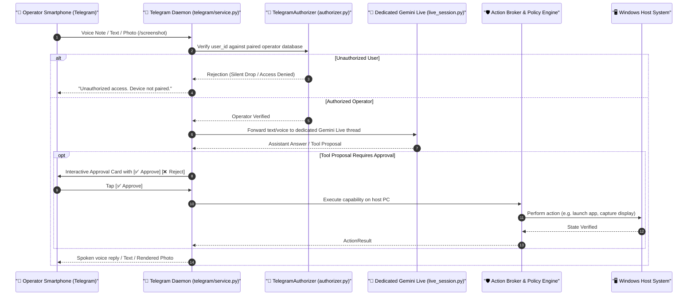

# Native Telegram Remote Control & Mobile Supervision

The **Telegram Remote Control Subsystem** ([`src/jarvis/telegram/`](file:///C:/Users/deepa/OneDrive/Desktop/JARVIS-WORKSPACE/src/jarvis/telegram/)) allows you to supervise, inspect, and command your PC remotely from any smartphone using Telegram.

---

## 1. Architectural Blueprint & Isolation



---

## 2. Cryptographic One-Time Pairing Protocol

To prevent unauthorized remote access, JARVIS enforces an explicit one-time pairing handshake:

1. **Initiate Pairing from PC:**
   ```powershell
   python -m jarvis.cli telegram pair
   ```
2. **Challenge Generation:**
   - The `TelegramPairingManager` generates a cryptographically random nonce (`pair_<hex32>`) with a strict 300-second TTL (`settings.TELEGRAM_PAIRING_TTL_SECONDS`).
   - Generates a deep link: `https://t.me/<your_bot_username>?start=pair_<nonce>`
3. **Operator Confirmation on Phone:**
   - Tap the link in Telegram on your phone and press **Start**.
   - The daemon captures your Telegram `user_id`, username, and authorization timestamp, writing it into persistent SQLite storage.
   - Once paired, the challenge nonce is immediately invalidated and destroyed.

---

## 3. Dedicated Parallel Gemini Live Session

Unlike architectures that share a single conversation buffer across all devices:
- Telegram operates its own dedicated **`TelegramLiveSession`** instance running parallel to the desktop voice session.
- Mobile messages will not collide with, interrupt, or overwrite the active conversational turns of an ongoing desktop voice session.
- Voice notes recorded in Telegram are streamed to the dedicated live session and synthesized back as natural spoken audio replies.

---

## 4. Direct PC File Delivery & Artifact Transmission

JARVIS can package local PC files and deliver them directly to your phone:

- **Screenshots:** Send `/screenshot` in Telegram. JARVIS captures the primary monitor via `computer.screenshot` and delivers a crisp PNG directly to your chat.
- **Documents & Code Patches:** When JARVIS generates a spreadsheet, PDF report, or code patch, the `artifact.deliver` capability transmits the document directly over Telegram up to 50MB (`TELEGRAM_MAX_UPLOAD_BYTES`).

---

## 5. Supported Telegram Commands

| Command | Action |
| :--- | :--- |
| `/start` | Welcomes user or accepts pairing challenge token. |
| `/status` | Returns host system diagnostic health (CPU, RAM, disk space, active window). |
| `/screenshot` | Captures the active Windows desktop and replies with an image file. |
| `/unpair` | Revokes the current device's authorization and disconnects remote access. |
| `/help` | Displays available capabilities, tools, and remote control instructions. |
