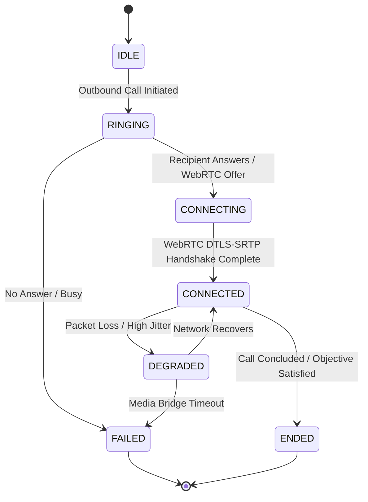

# Autonomous WhatsApp VoIP Telephony & Messaging

The **JARVIS WhatsApp Subsystem** ([`substrate/extensions/whatsapp/`](file:///C:/Users/deepa/OneDrive/Desktop/JARVIS-WORKSPACE/substrate/extensions/whatsapp/) and [`src/jarvis/execution/whatsapp/`](file:///C:/Users/deepa/OneDrive/Desktop/JARVIS-WORKSPACE/src/jarvis/execution/whatsapp/)) enables autonomous, full-duplex outbound voice calling and message coordination over WhatsApp.

Unlike conventional bots that only send text notifications, JARVIS integrates a low-latency WebRTC media bridge directly with the **Gemini 3.8 Live API**, conducting natural voice conversations, handling user interruptions, debriefing call outcomes, and writing verified facts into persistent conversational memory.

---

## 1. Architectural Hierarchy & Execution Model

```
JARVIS Python Cognitive Kernel / ActionBroker (src/jarvis/execution/whatsapp/)
   │ (CLI / Subprocess IPC with structured JSON output)
   ▼
JARVIS TypeScript Integration Layer (substrate/extensions/whatsapp/)
   │ (Single-instance lock, auth manager, call state machine, audio bridge)
   ▼
@oxidezap/baileyrs & @oxidezap/whatsapp-rust-bridge (WASM / JS)
   │ (WebAssembly / Native V8 bindings)
   ▼
oxidezap/whatsapp-rust Engine (Compiled Rust core)
   │ (Noise protocol, Signal crypto, SRTP encryption, Opus/MLow framing)
   ▼
WhatsApp Network Infrastructure
```

---

## 2. Invariants & Operational Guarantees

### 2.1 Single-Instance Session Lock Protocol
WhatsApp bans or resets credentials if concurrent sessions attempt to authenticate against the same state database:
- **Lock File:** `data/whatsapp/rust/lock/whatsapp.lock`
- **Fail-Fast Mechanism:** The TypeScript process acquires an exclusive file lock on boot. If another process holds the lock, newly spawned short-lived CLI commands defer or inspect read-only database mirrors without colliding.
- **Cleanup Guarantee:** Process exit hooks (`SIGINT`, `SIGTERM`, `exit`) unconditionally release the lock.

### 2.2 Strict Phone Number & LID Identity Resolution
WhatsApp accounts can be identified by standard phone numbers (`<phone>@s.whatsapp.net`) or opaque Linked Identity Descriptors (`<lid>@lid`). The `WhatsAppContactResolver` ([`src/jarvis/execution/whatsapp/resolver.py`](file:///C:/Users/deepa/OneDrive/Desktop/JARVIS-WORKSPACE/src/jarvis/execution/whatsapp/resolver.py)) resolves recipient names to verified JIDs while preserving exact identity mappings without strip-mangling.

---

## 3. VoIP Call Lifecycle & State Transitions

When an outbound call is placed, the call manager advances through an explicit state machine:



### 3.1 Real-Time Audio Coupling with Gemini Live
1. **Inbound WhatsApp Audio:** Encrypted SRTP audio packets from the recipient are decrypted by the WASM engine, decoded to 16kHz mono PCM, and piped directly into Gemini Live's WebSocket stream.
2. **Outbound Assistant Audio:** 24kHz audio emitted by Gemini Live is resampled, encoded into Opus frames, encrypted, and transmitted over WebRTC SRTP to WhatsApp servers.
3. **Barge-In:** When the recipient speaks while JARVIS is speaking, the audio feeder detects recipient speech, pauses assistant audio generation, and listens to the user's interruption.

---

## 4. Post-Call Debriefing & Grounded Memory Commitment

When a WhatsApp voice call concludes:
1. **Automated Debrief:** The call session extracts the complete dialogue transcript, duration, and objective resolution.
2. **Fact Verification:** Structured facts (e.g. *"Recipient confirmed the meeting for Thursday at 4 PM"*) are committed to SQLite memory:
   ```python
   await memory_manager.store_memory(
       category="whatsapp_call_debrief", content=f"Call to {target}: {outcome_summary}", importance=1.5
   )
   ```
3. **Operator Reporting:** A summary card is displayed in the Web UI and reported to the operator via Telegram or console.

---

## 5. Supported WhatsApp Commands

```powershell
# Initiate an autonomous goal-oriented voice call
python -m jarvis.cli whatsapp call --target "Mom" --objective "Wish her a happy birthday and ask if she needs anything"

# Display WhatsApp session status & connection health
python -m jarvis.cli whatsapp status

# Inspect recent call logs and transcripts
python -m jarvis.cli whatsapp history --limit 5

# Synchronize contacts and chat history
python -m jarvis.cli whatsapp sync

# Search unread messages and dialogue context
python -m jarvis.cli whatsapp unread --limit 10
```
