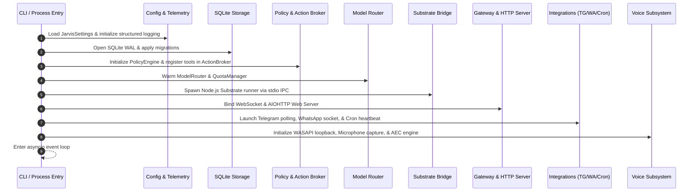
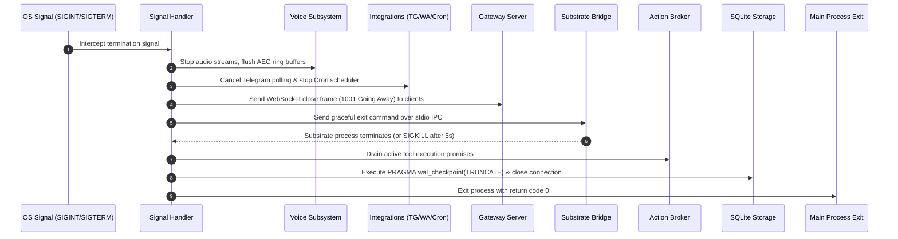

# JARVIS Startup and Shutdown Operations

This document describes the complete operational lifecycle of JARVIS, including bootstrapping sequence, service initialization, signal handling, and graceful teardown procedures.

---

## 1. System Bootstrapping Sequence

When launching JARVIS via `jarvis app`, `jarvis gateway`, or `python -m jarvis`, the system executes an ordered initialization sequence across all subsystems to ensure stable, verified dependencies.



### Detailed Bootstrapping Steps

1. **Configuration & Telemetry Initialization**:
   - `JarvisSettings` is instantiated from environment variables and `.env` files.
   - Pydantic validates all path formats, model names, numeric thresholds, and API keys.
   - Telemetry initializes structured JSON logging to stdout and rotating log files.

2. **Persistence & Migration Verification**:
   - `DatabaseEngine` establishes a connection to `jarvis.db` in the workspace or configured path.
   - SQLite execution pragmas are configured: `journal_mode=WAL`, `synchronous=NORMAL`, `foreign_keys=ON`, `busy_timeout=5000`.
   - `run_migrations()` checks the current schema version and applies any pending migrations (e.g. FTS5 index setup).

3. **Policy Engine & Tool Registry**:
   - `PolicyEngine` loads default permission tiers and capability masks.
   - `ActionBroker` discovers and registers all callable tools (Windows system automation, browser tools, computer control).
   - Tool capability schemas are indexed and linked to required permission flags.

4. **Cognitive Routing & Quotas**:
   - `ModelRouter` validates provider credentials (`GOOGLE_API_KEY`, `GROQ_API_KEY`).
   - `QuotaManager` loads historical usage for the current billing interval and resets daily limits if a day boundary has elapsed.
   - Primary candidate chains are compiled based on active settings.

5. **Execution Substrate Bridge**:
   - If Substrate execution is enabled, `SubstrateBridge` launches the Node.js TypeScript runner (`substrate/runner/jarvis_substrate_runner.ts`) as a managed child subprocess.
   - Stdio pipes are established for bidirectional JSON-RPC communication.
   - A `system.ping` handshake verifies process liveness and capability contracts.

6. **Network Gateway & Frontend Server**:
   - The Gateway WebSocket server binds to `GATEWAY_HOST` and `GATEWAY_PORT` (default: `127.0.0.1:8765`).
   - The AIOHTTP static server starts hosting the WebGL client from `frontend/` on `WEB_PORT` (default: `8080`).

7. **Background Integrations**:
   - If configured, `TelegramService` begins background long-polling or webhook processing.
   - `CronScheduler` registers scheduled jobs and starts the background heartbeat evaluation loop.
   - WhatsApp session monitors begin tracking message state.

8. **Voice Pipeline & Audio DSP**:
   - Audio input devices are enumerated and selected via PyAudio / WASAPI.
   - WASAPI loopback capture attaches to the default audio output render endpoint.
   - The `AudioAEC` engine initializes reference ring buffers, FFT plans, and PBFDAF filter taps.
   - TTS synthesizer warm-up sends a short silent utterance to ensure zero-latency initial responses.

---

## 2. Graceful Shutdown Sequence

JARVIS handles process termination signals (`SIGINT`, `SIGTERM`, or Windows console break events) deterministically to prevent corrupting databases, leaving orphaned child processes, or breaking external communication sockets.



### Shutdown Step Details

1. **Signal Interception**:
   - Signals are caught by `asyncio` event loop signal handlers (or Windows Console Ctrl Handler).
   - A single-entry shutdown lock prevents re-entrant teardown if multiple Ctrl+C inputs are received.

2. **Voice Deactivation**:
   - Microphone input stream is stopped and closed.
   - Loopback capture thread is signaled to break its processing loop.
   - Audio ring buffers are cleared to release memory.

3. **Integrations Halt**:
   - Telegram bot polling session is cancelled; active HTTP client sessions are closed cleanly.
   - WhatsApp Baileys socket is gracefully closed with an unbind notification.
   - Cron heartbeat timers are cancelled.

4. **Gateway Disconnection**:
   - Connected WebSocket clients (browser frontend, desktop overlays) receive a WebSocket close frame with status code `1001` ("Going Away").
   - AIOHTTP web server stops accepting new HTTP connections and shuts down active handlers.

5. **Substrate Process Teardown**:
   - `SubstrateBridge` writes a graceful exit frame (`{"jsonrpc": "2.0", "method": "system.shutdown"}`) to the Node.js runner stdio pipe.
   - The Python supervisor waits up to 5 seconds (`SUBSTRATE_SHUTDOWN_TIMEOUT`).
   - If the process does not terminate within the timeout, `process.kill()` sends `SIGKILL` to prevent orphaned background runners.

6. **In-Flight Action Draining**:
   - The Action Broker permits non-destructive active actions up to 3 seconds to complete.
   - Destructive or long-running tasks are aborted safely.

7. **Storage Checkpoint & Flush**:
   - Open SQLite transactions are finalized.
   - `PRAGMA wal_checkpoint(TRUNCATE)` is executed to commit all WAL pages back into the main `jarvis.db` file and truncate the write-ahead log.
   - Database connections are closed.

8. **Process Exit**:
   - Structured log records the shutdown duration and final metrics.
   - Process exits cleanly with status code `0`.

---

## 3. Launching JARVIS in Production

### 3.1. Standard Interactive Launch

```bash
# Start full desktop experience (Gateway, Web Server, Voice, and Shell)
jarvis app

# Launch specific background service
jarvis gateway --host 127.0.0.1 --port 8765
```

### 3.2. Headless Background Service on Windows

To run JARVIS continuously as a background service on Windows without an active command prompt window, use PowerShell with a scheduled task or service manager:

```powershell
# Create a Windows Scheduled Task running at startup
$Action = New-ScheduledTaskAction -Execute "uv" -Argument "run jarvis gateway --headless" -WorkingDirectory "C:\path\to\JARVIS-WORKSPACE"
$Trigger = New-ScheduledTaskTrigger -AtStartup
$Principal = New-ScheduledTaskPrincipal -UserId "SYSTEM" -LogonType ServiceAccount
Register-ScheduledTask -Action $Action -Trigger $Trigger -Principal $Principal -TaskName "JarvisGatewayService"
```

### 3.3. Headless Launch on Linux / WSL

```ini
# /etc/systemd/system/jarvis.service
[Unit]
Description=JARVIS AI Gateway and Control Plane
After=network.target

[Service]
Type=simple
User=jarvis
WorkingDirectory=/opt/jarvis
ExecStart=/opt/jarvis/.venv/bin/jarvis gateway --host 0.0.0.0 --port 8765
Restart=on-failure
RestartSec=5s
EnvironmentFile=/opt/jarvis/.env

[Install]
WantedBy=multi-user.target
```

---

## 4. Health Checks and Monitoring

JARVIS exposes an HTTP health endpoint when the web server is running:

```bash
curl http://localhost:8080/health
```

Expected response:
```json
{
  "status": "healthy",
  "version": "1.0.1",
  "uptime_seconds": 14285,
  "subsystems": {
    "database": "connected",
    "gateway": "active",
    "substrate": "running",
    "model_router": "ready",
    "voice_aec": "operational"
  }
}
```

If any critical subsystem fails (e.g. SQLite database locked, Substrate runner crashed), `/health` returns HTTP status `503 Service Unavailable` with details on the degraded component.
