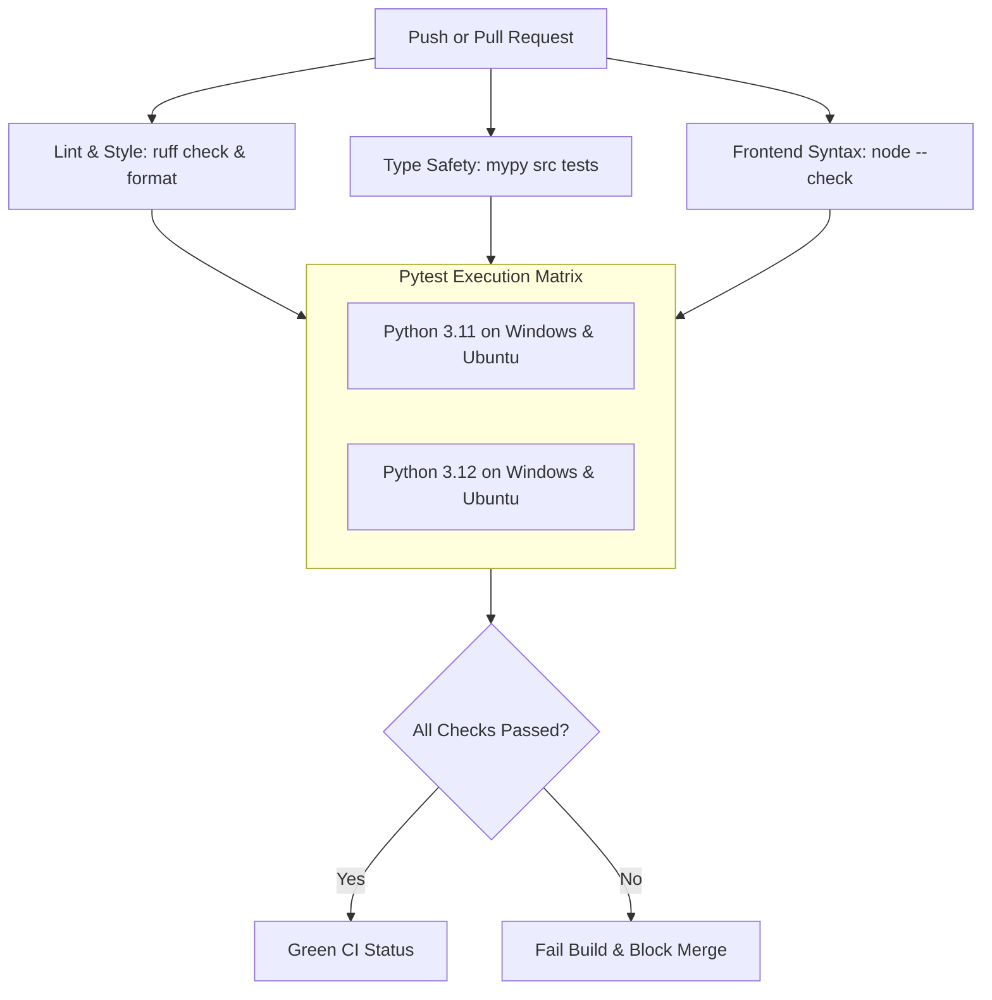

# Testing and Continuous Integration (CI)

This document outlines the testing strategy, test suites, quality gates, and Continuous Integration pipeline enforcing JARVIS software reliability.

---

## 1. Quality Gates and Standards

All code contributed to JARVIS must satisfy four strict quality gates before being merged:

1. **100% Test Pass Rate**: `pytest` must pass with zero failures or unexpected errors.
2. **100% Strict Type Safety**: `mypy src tests` must complete with zero type violations under strict mode.
3. **100% Clean Linting and Formatting**: `ruff check .` and `ruff format --check .` must report zero warnings or reformatting suggestions.
4. **Syntax Verification**: `node --check` must confirm valid syntax across all JavaScript client files.

---

## 2. Test Architecture

The JARVIS test suite is organized into distinct functional layers:

```
tests/
├── unit/                    # Fast, isolated tests of pure logic and algorithms
│   ├── test_config.py       # Configuration schema, environment variable overrides, defaults
│   ├── test_aec.py          # AEC DSP mathematical correctness, filter stability, DTD
│   ├── test_voice.py        # Voice state machine transitions, barge-in logic, VAD
│   ├── test_router.py       # Model router complexity scoring, provider candidate chains
│   ├── test_memory.py       # SQLite FTS5 search queries, temporal decay ranking formula
│   └── test_policy.py       # Capability firewall bitmasks, risk tier evaluation
├── integration/             # Multi-subsystem tests with mocked network endpoints
│   ├── test_control_plane.py# Full turn execution cycle: turn input -> model -> tool -> turn output
│   ├── test_gateway.py      # WebSocket client-server handshake, frame serialization, RPC
│   ├── test_substrate.py    # Python-to-TypeScript stdio JSON-RPC IPC bridge
│   └── test_database.py     # SQLite schema migrations and concurrent WAL read/writes
└── security/                # Penetration and boundary enforcement tests
    ├── test_firewall.py     # Forbidden path access, unauthorized capability elevation
    └── test_sanitization.py # Prompt injection defense and Markdown/HTML entity escaping
```

---

## 3. Running Local Verification Checks

### 3.1. Running Unit & Integration Tests

```bash
# Run the complete test suite
pytest

# Run tests with verbose output and timing
pytest -v --durations=10

# Run only unit tests
pytest tests/unit/

# Run a specific test file
pytest tests/unit/test_config.py

# Run tests with coverage analysis
pytest --cov=src/jarvis --cov-report=term-missing
```

### 3.2. Code Quality and Type Checking

```bash
# Check code formatting (dry run)
ruff format --check .

# Auto-format all Python code
ruff format .

# Run linter checks
ruff check .

# Run linter checks with automated safe fixes
ruff check --fix .

# Run strict static type checking
mypy src tests
```

### 3.3. Frontend Client Syntax Checks

```bash
# Verify JavaScript syntax across all client modules
node --check frontend/js/app.js
node --check frontend/js/config.js
node --check frontend/js/components/signal-orb.js
node --check frontend/js/gateway/client.js
```

---

## 4. Continuous Integration Pipeline

JARVIS uses GitHub Actions (`.github/workflows/ci.yml`) to enforce automated verification on all pull requests and branch pushes.

### 4.1. CI Workflow Structure



### 4.2. Workflow Definition Highlights

The CI pipeline runs on both Windows and Ubuntu runners to maintain cross-platform portability:

```yaml
name: CI

on:
  push:
    branches: [main, cleanup/*, feature/*]
  pull_request:
    branches: [main]

jobs:
  lint-and-typecheck:
    runs-on: ubuntu-latest
    steps:
      - uses: actions/checkout@v4
      - uses: actions/setup-python@v5
        with:
          python-version: "3.11"
      - name: Install dependencies
        run: |
          pip install uv
          uv pip install --system -e ".[dev]"
      - name: Ruff Check
        run: ruff check .
      - name: Ruff Format Check
        run: ruff format --check .
      - name: Mypy Strict Check
        run: mypy src tests

  test:
    needs: lint-and-typecheck
    strategy:
      matrix:
        os: [ubuntu-latest, windows-latest]
        python-version: ["3.11", "3.12"]
    runs-on: ${{ matrix.os }}
    steps:
      - uses: actions/checkout@v4
      - uses: actions/setup-python@v5
        with:
          python-version: ${{ matrix.python-version }}
      - name: Install dependencies
        run: |
          pip install uv
          uv pip install --system -e ".[dev]"
      - name: Run Pytest
        run: pytest -v
```

---

## 5. Guidelines for Writing Tests

### 5.1. Determinism and Zero External Network Calls
Unit and integration tests must never depend on live external network endpoints or live cloud APIs (such as live Gemini or Groq endpoints).
- Use `unittest.mock` or `pytest-mock` to stub HTTP and WebSocket client responses.
- Test failure modes, unexpected network disconnects, and JSON decoding errors explicitly.

### 5.2. Async Test Conventions
JARVIS relies heavily on `asyncio`. Tests targeting coroutines must be marked with `@pytest.mark.asyncio`:

```python
import pytest
from jarvis.memory.working import WorkingMemory
from jarvis.contracts.memory import TurnRecord


@pytest.mark.asyncio
async def test_working_memory_append_and_truncate():
    memory = WorkingMemory(capacity=5)
    for i in range(10):
        await memory.add_turn(TurnRecord(role="user", content=f"msg {i}"))

    turns = await memory.get_recent_turns()
    assert len(turns) == 5
    assert turns[-1].content == "msg 9"
```

### 5.3. Cross-Platform Path Handling
Always use `pathlib.Path` or `tmp_path` fixtures rather than hardcoded path strings with backslashes or forward slashes to ensure tests pass on both Windows and Linux environments.
