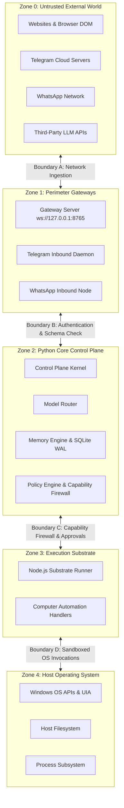

# JARVIS Threat Model and Trust Architecture

This document defines the formal threat model, security boundaries, trust assumptions, authorization hierarchy, and defense-in-depth mitigations governing JARVIS.

---

## 1. Trust Boundaries and System Zones

JARVIS partitions its operational environment into five distinct trust zones separated by explicit security boundaries:



### Trust Boundary Descriptions

- **Boundary A (External Ingestion)**: Ingests untrusted data from the internet (web search results, browser page DOMs, incoming Telegram messages, WhatsApp packets).
- **Boundary B (Perimeter to Control Plane)**: Verifies client authenticity (WebSocket challenge nonces, Telegram user whitelist, WhatsApp session tokens).
- **Boundary C (Control Plane to Substrate)**: Governs tool execution requests generated by cognitive models. All requests pass through the Capability Firewall and Approval Engine.
- **Boundary D (Substrate to Host OS)**: Translates approved commands to Win32 APIs, UI Automation COM calls, or sandboxed filesystem operations.

---

## 2. Threat Assumptions and Adversarial Vectors

JARVIS is designed under the assumption of hostile, untrusted external environments:

1. **Untrusted Web Content & Indirect Prompt Injection**:
   - Web pages, search snippets, and browser DOM elements fetched during browsing may contain malicious adversarial prompts designed to hijack cognitive model instructions (indirect prompt injection).
2. **Probabilistic and Hallucinatory Models**:
   - Even legitimate LLMs may hallucinate nonexistent arguments, propose destructive commands, or attempt path traversals.
3. **Remote Channel Spoofing**:
   - Attackers may attempt to message the Telegram bot from unauthorized accounts or manipulate chat callbacks.
4. **Local Network Cross-Origin Attacks**:
   - Malicious websites opened in a user's browser could attempt cross-origin WebSocket requests to `ws://127.0.0.1:8765` to command JARVIS.
5. **Accidental Operator Destruction**:
   - The user or assistant might accidentally trigger commands that wipe critical directories or terminate essential operating system services.

---

## 3. Defense-in-Depth Security Mitigations

### 3.1. Capability Firewall (`src/jarvis/policy/firewall.py`)

Every tool exposed to cognitive models requires explicit capabilities represented by bitmasks:

```python
CAPABILITY_SYSTEM_READ = 1 << 0  # Read host metrics, window titles
CAPABILITY_FS_READ = 1 << 1  # Read sandboxed files
CAPABILITY_FS_WRITE = 1 << 2  # Write or modify files
CAPABILITY_SYSTEM_EXEC = 1 << 3  # Spawn processes or shell commands
CAPABILITY_BROWSER = 1 << 4  # Open and manipulate web pages
CAPABILITY_NETWORK_CALL = 1 << 5  # Outbound VoIP calls or network connections
```

- **Path Traversal Guards**: Any file path containing `..`, absolute root paths outside configured workspaces, or system directories (`C:\Windows`, `C:\Program Files`) is blocked immediately with a security exception.
- **Strict Parameter Schema Validation**: Model arguments are parsed through Pydantic schemas. Excess or unvalidated parameters are discarded.

---

### 3.2. Risk Tiers and Human-in-the-Loop Approvals

The Policy Engine classifies all actions into four risk tiers:

| Risk Tier | Examples | Execution Policy |
| :--- | :--- | :--- |
| **Tier 1 (LOW)** | `system_get_metrics`, `window_list`, `memory_search` | Automatically approved and executed. |
| **Tier 2 (MEDIUM)** | `file_write_scratch`, `browser_navigate`, `app_focus` | Executed automatically with structured audit trail logging. |
| **Tier 3 (HIGH)** | `shell_execute`, `file_delete`, `app_terminate` | **Requires explicit operator confirmation** via Web UI modal or Telegram inline keyboard. |
| **Tier 4 (CRITICAL)** | `system_shutdown`, `registry_write`, `disk_format` | **Hard-blocked by default**; requires manual administrative override flag. |

#### Interactive Approval Flow
- High-risk operations generate an `ApprovalTicket` containing a cryptographic HMAC nonce, action parameters, and a 60-second Time-To-Live (TTL).
- The ticket is displayed on the desktop UI and forwarded to authorized Telegram sessions.
- Execution is suspended until the user clicks `[ AUTHORIZE ]`. If no response is received within the TTL, the ticket expires and the action is safely cancelled.

---

### 3.3. Remote Access Authentication

- **Telegram Bot Access**:
  - Operates on a **fail-closed whitelist**. If an incoming Telegram message originates from a user ID not in `TELEGRAM_ALLOWED_USERS`, the packet is dropped immediately with an audit log.
  - Initial pairing requires the user to run `jarvis telegram pair` locally in the console, generating a 6-digit challenge code with a 5-minute TTL.
- **Gateway WebSocket Security**:
  - Gateway enforces an initial challenge-response handshake (`connect.challenge`).
  - Origin verification rejects WebSocket connections from unauthorized web origins to defend against cross-site hijacking.

---

### 3.4. Prompt Injection Defenses

1. **System Instruction Isolation**: System prompts and user instructions are separated from untrusted external content. Web search results and scraped DOM trees are wrapped in isolated data blocks with explicit delimitation.
2. **Action Boundary Enforcement**: An LLM cannot execute tools directly; it can only request tool calls that must satisfy schema validation and the Capability Firewall.
3. **Output Sanitization**: All content streamed to Telegram or web browsers is sanitized to prevent HTML/Markdown injection attacks or terminal ANSI escape sequence exploits.

---

### 3.5. Secrets and Credential Safety

- **Zero Hardcoding**: Credentials, API tokens (`GOOGLE_API_KEY`, `GROQ_API_KEY`, `TELEGRAM_BOT_TOKEN`), and private paths must never be hardcoded in the codebase.
- **Gitignore Invariant**: Private session stores (`sessions.json`, `conversations.json`), logs (`*.log`), databases (`jarvis.db`), and environment configurations (`.env`) are strictly gitignored.
- **Log Masking**: Telemetry filters automatically mask sensitive keys, authorization tokens, and credentials before writing to log files or standard output.
