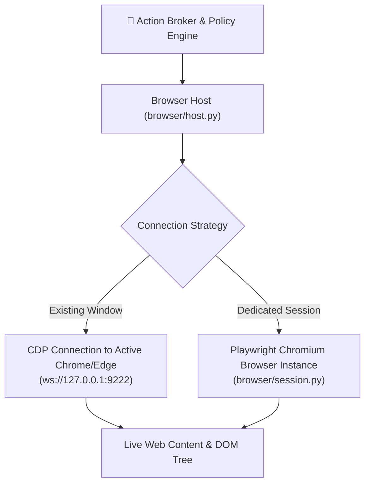

# Browser Automation Subsystem (Playwright & CDP)

The **Browser Automation Subsystem** ([`src/jarvis/execution/browser/`](file:///C:/Users/deepa/OneDrive/Desktop/JARVIS-WORKSPACE/src/jarvis/execution/browser/)) provides programmatic web browsing, web search extraction, and DOM element automation powered by **Playwright** and the **Chrome DevTools Protocol (CDP)**.

---

## 1. Architectural Architecture & Modes

The browser subsystem operates in two complementary execution modes:



1. **CDP Connection to Running Browser:** Attaches to an existing Chrome or Edge instance running with `--remote-debugging-port=9222`, allowing JARVIS to inspect tabs without stealing operator session cookies.
2. **Dedicated Managed Playwright Instance:** Launches an isolated Chromium instance configured through `settings.BROWSER_HEADLESS` (default: `False`) and `settings.BROWSER_CHANNEL` (default: `"chrome"`).

---

## 2. Core Browser Capabilities

The browser subsystem exposes five canonical capabilities to the Action Broker:

| Capability | Canonical Name | Description |
| :--- | :--- | :--- |
| **Navigation** | `browser.navigate` | Navigates to a target URL, waiting for `domcontentloaded` or `networkidle`. |
| **DOM Snapshot** | `browser.snapshot` | Extracts a structured, simplified text representation of actionable DOM nodes (links, buttons, inputs). |
| **Element Click** | `browser.click` | Dispatches simulated mouse clicks against elements resolved via text, CSS selector, or XPath. |
| **Text Entry** | `browser.type` | Focuses target input or textarea and types string contents cleanly. |
| **Page Screenshot** | `browser.screenshot` | Captures high-resolution viewport or full-page screenshots for multimodal vision models. |

---

## 3. DOM Tree Normalization & Token Preservation

Raw HTML DOM trees typically contain hundreds of kilobytes of CSS classes, SVG paths, script tags, and tracking pixels. The `BrowserSession` ([`src/jarvis/execution/browser/session.py`](file:///C:/Users/deepa/OneDrive/Desktop/JARVIS-WORKSPACE/src/jarvis/execution/browser/session.py)) extracts only interactive, semantically meaningful controls:

```html
<!-- Raw Web DOM -->
<div class="header-nav-item dropdown-menu-container">
  <button id="btn-submit-order" aria-label="Submit Order" class="btn btn-primary">
    <span>Submit Order ($49.00)</span>
  </button>
</div>

<!-- Normalized Representation Fed to Model -->
[Button: "Submit Order ($49.00)" | ID: "btn-submit-order"]
```

---

## 4. Session Isolation & Resource Lifecycle

- **Automatic Teardown:** When a browser session completes or times out, all open browser contexts, incognito storage, and temporary download directories are cleanly purged.
- **Download Handling:** Files downloaded through browser actions are routed directly to the managed `settings.ARTIFACTS_DIR` and registered with the Artifact Store.
