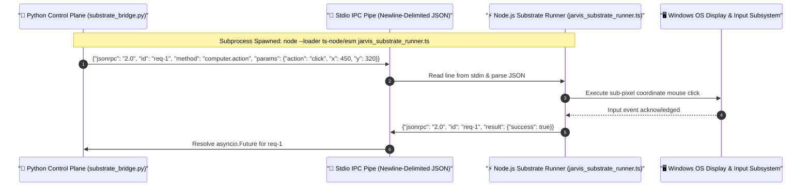

# Execution Substrate Daemon & JSON-RPC IPC

The **Execution Substrate** ([`substrate/`](file:///C:/Users/deepa/OneDrive/Desktop/JARVIS-WORKSPACE/substrate/)) is a high-speed TypeScript/Node.js subsystem that provides low-level OS primitives, sub-pixel mouse/keyboard coordinate control, screen display capture, and malformed tool-call repair.

---

## 1. IPC Architecture & Process Boundaries

Rather than re-spawning Node.js runtimes for every action (which introduces high latency), JARVIS maintains a **persistent background Node.js daemon** managed by the Python `SubstrateBridge` ([`src/jarvis/execution/substrate_bridge.py`](file:///C:/Users/deepa/OneDrive/Desktop/JARVIS-WORKSPACE/src/jarvis/execution/substrate_bridge.py)):



---

## 2. Core Substrate Capabilities

### 2.1 Coordinate Input Simulation (`computer.action`)
Provides coordinate-level fallback when COM UI Automation is unavailable (e.g. customized canvas games, non-standard GUI toolkits, direct DirectX surfaces):
- **`click` / `doubleClick` / `rightClick`:** Coordinates $(x, y)$.
- **`move`:** Smooth mouse interpolation with acceleration curves.
- **`mouseDown` / `mouseUp`:** Drag-and-drop operations.
- **`type`:** Text injection with realistic inter-keystroke jitter.
- **`pressKey` / `keyDown` / `keyUp`:** System key combos (e.g. `Ctrl+Alt+Del`, `Win+R`, `Alt+F4`).

### 2.2 Screen Display Pipeline (`system.snapshot`)
Captures full-screen or region display snapshots directly from the Windows Desktop Duplication API:
- Returns JPEG or PNG base64-encoded frames.
- Sub-15ms frame capture latency enables real-time visual perception for Gemini Live.

### 2.3 Syntactic Tool Call Repair (`tool_call.repair`)
LLMs occasionally emit slightly malformed, truncated, or unescaped JSON strings when proposing complex tool arguments. The Substrate integrates the `@jarvis/tool-call-repair` engine:
- Repairs unescaped quotes inside string values.
- Recovers truncated JSON arrays and closing braces.
- Normalizes type mismatches (e.g. string `"123"` to integer `123` where expected by schemas) before dispatching to the Action Broker.

---

## 3. Resilience, Concurrency & Crash Recovery

- **Request Futures Table:** Python tracks pending asynchronous requests using an internal table:
  ```python
  self._pending_requests: Dict[str, asyncio.Future[Dict[str, Any]]] = {}
  ```
- **Auto-Restart on Crash:** If the Node.js process exits unexpectedly (e.g. unhandled OS exception or killed by task manager), `SubstrateBridge` detects the EOF, rejects all pending requests cleanly with `SubstrateBridgeError`, and automatically spawns a fresh daemon instance.
- **Graceful Shutdown:** On session exit, Python sends a termination signal, closes stdin, and waits up to 2 seconds for clean exit before issuing `SIGKILL`.
