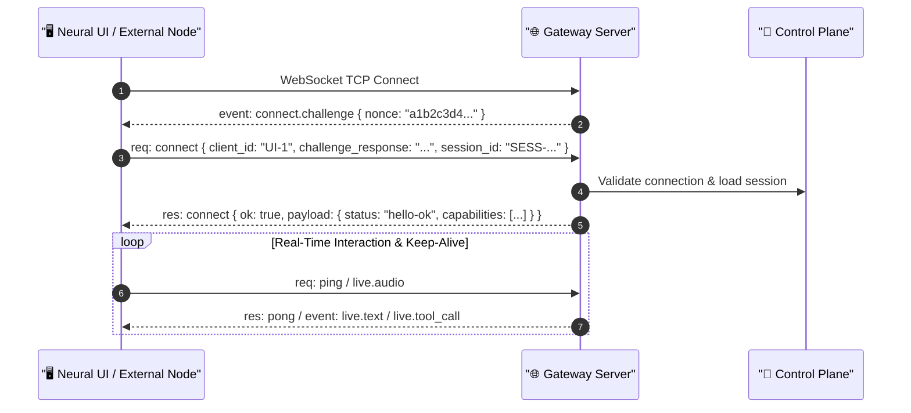

# Gateway Daemon & WebSocket Wire Protocol

The **JARVIS Gateway** ([`src/jarvis/gateway/server.py`](file:///C:/Users/deepa/OneDrive/Desktop/JARVIS-WORKSPACE/src/jarvis/gateway/server.py)) runs a high-performance asynchronous WebSocket daemon that serves as the primary real-time integration bus between the Python Control Plane, the Neural Web UI, and external platform nodes.

---

## 1. Network Topology & Port Resolution

- **Default Endpoint:** `ws://127.0.0.1:8765`
- **Dynamic Port Auto-Discovery:** If port `8765` is bound by another service, the Gateway scans up to 50 sequential ports (`settings.GATEWAY_PORT_SEARCH_LIMIT`) and binds the first available port.
- **UI Web Server:** A co-located lightweight HTTP daemon ([`src/jarvis/gateway/web_server.py`](file:///C:/Users/deepa/OneDrive/Desktop/JARVIS-WORKSPACE/src/jarvis/gateway/web_server.py)) serves the static assets in [`frontend/`](file:///C:/Users/deepa/OneDrive/Desktop/JARVIS-WORKSPACE/frontend/) on port `8080`, injecting the active gateway port dynamically via URL parameters (`?gw=8765`).

---

## 2. Wire Protocol Envelopes

All wire messages adhere to three canonical JSON envelopes defined in [`src/jarvis/gateway/protocol.py`](file:///C:/Users/deepa/OneDrive/Desktop/JARVIS-WORKSPACE/src/jarvis/gateway/protocol.py):

### 2.1 Request Frame (`req`)
Sent from client to server to invoke an RPC method:
```json
{
  "type": "req",
  "id": "req-9a8f1b2c",
  "method": "task.create",
  "params": {
    "intent": "Organize desktop downloads",
    "session_id": "SESS-001"
  }
}
```

### 2.2 Response Frame (`res`)
Sent from server to client answering a specific request:
```json
{
  "type": "res",
  "id": "req-9a8f1b2c",
  "ok": true,
  "payload": {
    "task_id": "TASK-1042",
    "status": "QUEUED"
  },
  "error": null
}
```

### 2.3 Event Frame (`event`)
Pushed asynchronously from server to client to broadcast streaming telemetry or live audio:
```json
{
  "type": "event",
  "event": "live.audio",
  "payload": {
    "pcm_base64": "UklGRiQAAABXQVZFZm10IB...",
    "sample_rate": 24000
  },
  "seq": 42
}
```

---

## 3. Handshake & Authentication Protocol

When a client opens a WebSocket connection to the Gateway, it undergoes a structured challenge-response handshake:



---

## 4. Supported RPC Methods & Event Types

### Canonical RPC Methods (`ProtocolMethod`):
- **`connect`:** Handshake initialization and capability verification.
- **`health`:** Returns host system diagnostic health and registered execution nodes.
- **`task.create` / `task.get` / `task.cancel`:** Asynchronous background task lifecycle management.
- **`action.approve`:** Approves or rejects a gated high-risk action.
- **`memory.search` / `memory.store`:** Interacts with the persistent SQLite FTS5 memory store.
- **`artifacts.list` / `artifacts.get` / `artifacts.download`:** Manages sidecar files and desktop screenshots.

### Canonical Events (`ProtocolEvent`):
- **`live.audio`:** Chunks of synthesized 24kHz assistant speech for real-time playback.
- **`live.text`:** Streaming transcription text chunks for immediate display.
- **`live.tool_call`:** Notification that an action has been proposed and is executing.
- **`live.tool_complete`:** Action execution result with verification metadata.
- **`live.interrupted`:** Fired when user barge-in cuts the assistant's speech.
- **`live.turn_complete`:** Signals that the current conversational turn is finalized.
- **`approval.required`:** Pushes an interactive confirmation dialog for high-risk operations.
