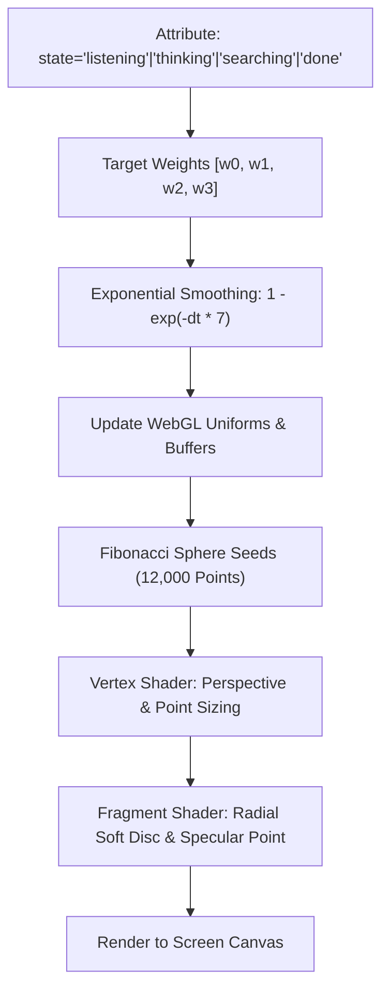

# Neural 3D Interface, Signal Orb & Kinetic Typography

The **JARVIS Neural Web Interface** ([`frontend/`](file:///C:/Users/deepa/OneDrive/Desktop/JARVIS-WORKSPACE/frontend/)) provides a zero-dependency, GPU-accelerated desktop UI featuring procedural WebGL orbs, synchronized typography flight, and an ambient 3D particle field.

---

## 1. Frontend Subsystem Structure

```
frontend/
├── index.html                   # Primary application layout & component mount
├── css/
│   ├── main.css                 # Design tokens, typography, dark canvas styles
│   └── orbs.css                 # Dual-orb layout, container aspect ratios
└── js/
    ├── app.js                   # Application coordinator, DOM events, shortcuts
    ├── config.js                # Dynamic runtime configuration & URL parameters
    ├── audio/
    │   ├── player.js            # Web Audio API 24kHz PCM stream player
    │   └── recorder.js          # AudioWorklet microphone capture
    ├── components/
    │   ├── signal-orb.js        # 3D Fibonacci WebGL particle sphere (<signal-orb>)
    │   ├── speaking-orb.js      # Monotonic kinetic typography sphere (<speaking-orb>)
    │   └── particle-field.js    # 3D ambient depth particle field (<particle-field>)
    └── gateway/
        └── client.js            # Typed WebSocket RPC & event client
```

---

## 2. Signal Orb Web Component (`<signal-orb>`)

The **Signal Orb** ([`frontend/js/components/signal-orb.js`](file:///C:/Users/deepa/OneDrive/Desktop/JARVIS-WORKSPACE/frontend/js/components/signal-orb.js)) is a custom HTML element rendering a 12,000-particle sphere driven by pure WebGL and procedural mathematical geometry.



### 2.1 The Fibonacci Sphere Seed Algorithm
Points are distributed evenly across the sphere using the spherical Fibonacci spiral:

$$y_i = 1 - \frac{2(i + 0.5)}{N}, \quad \theta_i = i \times \phi_{\text{golden}}, \quad r_i = \sqrt{1 - y_i^2}$$
$$x_i = r_i \cos(\theta_i), \quad z_i = r_i \sin(\theta_i)$$

### 2.2 Visual Modes & Color Palettes
| Mode | Primary RGB | Secondary RGB | Geometry & Visual Behavior |
| :--- | :--- | :--- | :--- |
| **`listening`** | `[255, 185, 105]` (Warm Gold) | `[255, 226, 190]` | Relaxed breathing pulse responding to microphone input energy. |
| **`thinking`** | `[178, 151, 255]` (Violet) | `[120, 200, 255]` | Rapid chaotic turbulent rotation simulating deep neural calculation. |
| **`searching`** | `[97, 219, 249]` (Cyan) | `[190, 245, 255]` | Particles collapse into high-speed orbiting planetary rings. |
| **`done`** | `[136, 239, 194]` (Mint Green) | `[210, 255, 236]` | Smoothly settles into a stable resting equilibrium sphere. |

---

## 3. Kinetic Typography Flight (`<speaking-orb>`)

The **Speaking Orb** ([`frontend/js/components/speaking-orb.js`](file:///C:/Users/deepa/OneDrive/Desktop/JARVIS-WORKSPACE/frontend/js/components/speaking-orb.js)) visualizes spoken responses as words flying outward from the particle core in real time.

### Monotonic Wall-Clock Synchronization
To prevent text desynchronization when backgrounding the browser tab or encountering CPU spikes:
- Word flight timing is locked to monotonic high-resolution timestamps:
  ```javascript
  const elapsed = (performance.now() - word.startTime) / 1000;
  ```
- Words follow a parameterized cubic easing curve with perspective distance scaling:
  $$z = z_0 + v_z \cdot t, \quad \text{scale} = \frac{f}{f + z}$$
- Words fade out smoothly as they pass the camera clipping plane.

---

## 4. Ambient 3D Particle Field (`<particle-field>`)

The background particle system ([`frontend/js/components/particle-field.js`](file:///C:/Users/deepa/OneDrive/Desktop/JARVIS-WORKSPACE/frontend/js/components/particle-field.js)) projects 5,200 depth particles across the viewport:
- **Interactive Mouse Parallax:** Computes smooth mouse deflection offsets with damping.
- **Dynamic Speed & Swirl:** Synchronizes drift speed and vortex swirl to current assistant states (e.g. forward warp speed during `searching`, gentle drift during `listening`).

---

## 5. Keyboard Shortcuts & Accessibility

- **`Ctrl + M` or `Cmd + M`:** Toggle microphone mute/unmute.
- **`/`:** Focus text query input.
- **`Esc`:** Dismiss active modal or clear prompt input.
- **Reduced Motion Support:** Respects `prefers-reduced-motion: reduce` by disabling turbulent animations and locking orbs to static geometry.
