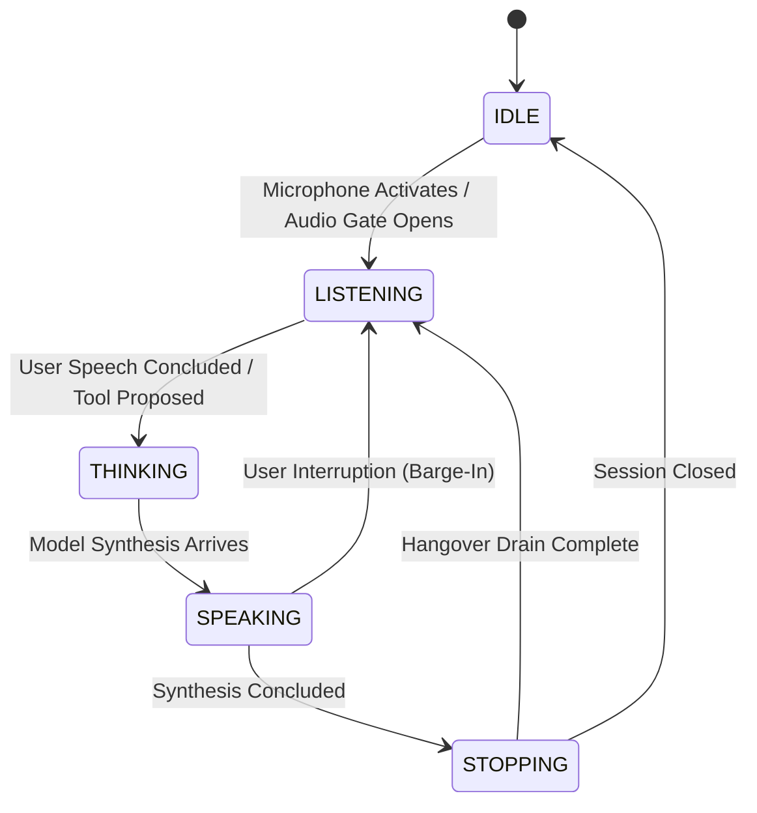

# Voice Pipeline, Audio Streaming & Barge-In

The **JARVIS Voice Subsystem** ([`src/jarvis/voice/`](file:///C:/Users/deepa/OneDrive/Desktop/JARVIS-WORKSPACE/src/jarvis/voice/)) delivers low-latency, full-duplex conversational voice interaction with real-time barge-in capability. It ensures natural dialogue flow by preventing speech overlap and assistant self-echo.

---

## 1. End-to-End Voice Pipeline Architecture

```mermaid
graph LR
    subgraph INGRESS ["Microphone & Audio Ingress"]
        Mic["🎤 Physical Microphone"] --> MicCapture["MicrophoneCapture (microphone.py)"]
        MicCapture --> InputGate["AudioInputGate (input_gate.py)"]
        InputGate --> AECFilter["Acoustic Echo Canceller (audio_aec.py)"]
    end

    subgraph COGNITION ["Multimodal Cognitive Loop"]
        AECFilter -->|16kHz 16-bit Mono PCM| GeminiLive["⚡ Gemini 3.8 Live API"]
        GeminiLive -->|24kHz Synthesized Audio| AudioQueue["Audio Chunk Queue"]
    end

    subgraph EGRESS ["Playback & Hardware Drain"]
        AudioQueue --> Player["PcmStreamPlayer (synthesizer.py)"]
        Player --> Soundcard["🔊 Physical Speakers"]
        Soundcard --> LoopbackCapture["WASAPI Loopback Capture"]
        LoopbackCapture -->|Reference Audio x(n)| AECFilter
        Player --> OutputTracker["PlaybackActivityTracker (output_tracker.py)"]
    end
```

---

## 2. Voice State Machine

The interaction cycle is governed by the `VoiceStateMachine` ([`src/jarvis/voice/state_machine.py`](file:///C:/Users/deepa/OneDrive/Desktop/JARVIS-WORKSPACE/src/jarvis/voice/state_machine.py)):



### Voice States:
- **`VoiceState.IDLE`:** Microphone inactive; audio processing in sleep mode.
- **`VoiceState.LISTENING`:** Microphone active; VAD energy monitored; 16kHz PCM audio frames streamed to cognitive engine.
- **`VoiceState.THINKING`:** User has stopped speaking; cognitive reasoning or tool execution in flight.
- **`VoiceState.SPEAKING`:** Synthesizer actively outputting 24kHz assistant voice frames to physical speakers.
- **`VoiceState.STOPPING`:** Speech buffer drain phase with hangover guard (`VOICE_DRAIN_HOLD_MS = 250ms`) preventing trailing echoes from re-triggering listening.

---

## 3. Real-Time Barge-In & Speech Interruption

Barge-in allows the operator to speak naturally while the assistant is speaking, instantaneously interrupting the assistant without waiting for the response to finish:

1. **Physical Sound Isolation:** The assistant's voice playing through physical speakers is captured via WASAPI loopback and subtracted by the AEC filter.
2. **True Human Voice Detection:** When the operator speaks, the user's voice cannot be cancelled by the speaker reference. The `AudioInputGate` detects energy exceeding `AUDIO_VAD_ENERGY_THRESHOLD`.
3. **Instantaneous Cancellation:**
   - `VoiceStateMachine.transition(VoiceState.LISTENING, reason="User interrupted")` fires.
   - `PcmStreamPlayer.stop()` immediately clears the audio output buffer, silencing the speakers within 15ms.
   - A cancellation signal is dispatched to the active Live session over WebSocket.

---

## 4. Playback Activity Tracking & Hardware Drain Guard

When digital audio frames finish writing to the OS audio subsystem, physical sound waves continue emitting from speaker cones for an additional 100-250ms due to soundcard hardware buffering:

- The `PlaybackActivityTracker` ([`src/jarvis/voice/output_tracker.py`](file:///C:/Users/deepa/OneDrive/Desktop/JARVIS-WORKSPACE/src/jarvis/voice/output_tracker.py)) monitors the monotonic hardware clock.
- It prevents the microphone input gate from interpreting the hardware buffer tail as a new user query.
- The `VOICE_DRAIN_HOLD_MS` setting (default: 250ms) guarantees a clean, silent transition between assistant speech and user speech.
